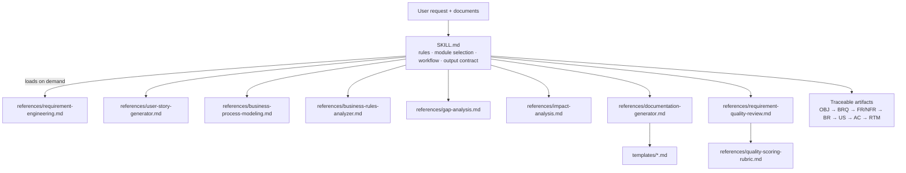
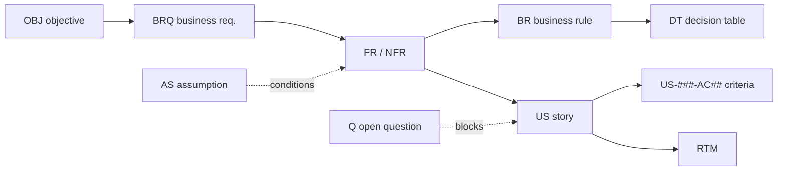
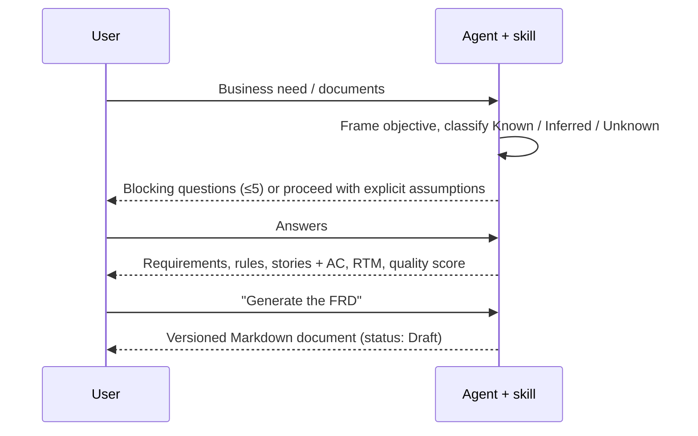

# Intelligent Business Analyst

**An open-source Agent Skill that turns business needs into structured, verifiable and traceable
requirements, ready for development and QA.**

[](LICENSE)


📘 **User manual (Spanish, PDF):** [docs/Manual-de-usuario.pdf](docs/Manual-de-usuario.pdf)

## 1. Project overview

Intelligent Business Analyst is a portable skill for AI agents that support the `SKILL.md` format
(Claude Code, Claude apps, OpenAI Codex and others). It makes the agent act as a **senior Business
Analyst** across the full analysis cycle:


It does not just generate documents. It reads critically, separates what is **confirmed** from what
is **inferred** or **unknown**, surfaces contradictions and missing information, asks prioritized
questions and keeps every artifact linked to its source. It never invents business rules, thresholds,
regulations or approvals — unknown values stay `TBD` with an open question.

Built for Business Analysts, Product Owners and Managers, Technical POs, software and QA engineers,
solution architects and Agile / digital transformation teams working on digital products, enterprise
platforms, REST APIs and integrations, automation, legacy processes and AI-powered features.

## 2. Key features

| Module | What it produces |
|---|---|
| 01 Requirement Engineering | Business / functional / non-functional requirements, stakeholder matrix, assumptions & constraints, prioritized discovery questions, initial RTM, conflict detection |
| 02 User Story Generator | Epics, features, stories with Given/When/Then AC (positive, negative, edge), INVEST check, MoSCoW (proposed), Definition of Ready, splitting, Jira/Azure DevOps-ready text |
| 03 Business Process Modeling | AS-IS / TO-BE descriptions, Mermaid diagrams, BPMN 2.0 specification or XML (only when structurally complete), improvement opportunities |
| 04 Business Rules Analyzer | Rule catalog (Confirmed / Proposed / Pending Validation), decision tables with completeness and overlap checks, conflict findings |
| 05 Gap Analysis | Gap register by dimension, qualitative impact, priorities, recommendations, quick wins |
| 06 Impact Analysis | Change impact matrix with severity and confidence, dependency map, regression areas, risk register — no invented estimates |
| 07 Documentation Generator | BRD, FRD, SRS, user stories spec, rules catalog, use cases, process analysis, gap & impact reports, RTM — versioned Markdown |
| 08 Requirement Quality Review | Findings with severity and verbatim evidence, corrected versions side by side, **Requirement Quality Score 0–100** (heuristic, documented rubric) |

Cross-cutting behaviour: responds in the user's language, treats input documents as data (prompt-
injection resistant), uses a stable ID scheme across artifacts, and scales output to the request.

## 3. Supported platforms

| Platform | Install location / method | Status |
|---|---|---|
| Claude Code | `skills` CLI (`-a claude-code`), or clone into `~/.claude/skills/` (personal) / `.claude/skills/` (project) | Designed for; structure follows the documented skill layout |
| Claude apps (claude.ai, desktop) | Upload a ZIP where custom skills are enabled for your plan | Designed for; availability depends on plan and settings |
| OpenAI Codex | User or repository skills directory documented for your Codex version | Format-compatible (`SKILL.md` + `agents/openai.yaml`); **not yet tested end to end** |
| Other agents (via `skills` CLI) | `npx skills add …` | Depends on the agent's skill support |
| Assistants without skill support | Paste `SKILL.md` as instructions, attach `references/` as knowledge | Works as plain instructions; no automatic module loading |

The skill needs no code execution, network access or API calls. The only script
(`tests/validate_repo.py`) is a development aid.

## 4. Architecture



**Progressive disclosure:** `SKILL.md` is short and always loaded when the skill triggers; the agent
reads a module reference only when that module is needed, and a template only when a document is
requested.

```text
intelligent-business-analyst/
├── SKILL.md                 # entry point (frontmatter + core instructions)
├── agents/openai.yaml       # optional Codex display metadata
├── references/              # one file per module + scoring rubric
├── templates/               # BRD, FRD/SRS, stories, rules, gap, impact, use case, RTM
├── examples/                # ecommerce (ES), insurance-api, ai-product
└── tests/                   # behavioural test cases, evaluation rubric, reference outputs, validator
```

**Traceability model**



## 5. Installation

The repository root **is** the skill folder. The installed folder must be named
`intelligent-business-analyst` (the skill `name`).

> **Supply-chain note.** The commands below are pinned to the release tag `v1.0.0`
> rather than the moving default branch. Before installing, review the files you are about to
> load (`SKILL.md`, `references/`, `templates/`): the skill is plain Markdown, has no runtime
> dependencies and fetches nothing at run time. To verify a clone, compare
> `git rev-parse v1.0.0` with the commit listed on the
> [release page](https://github.com/titoparra4/intelligent-business-analyst/releases/tag/v1.0.0).

### skills.sh (`skills` CLI) — recommended

Install with the third-party [`skills` CLI](https://github.com/vercel-labs/skills), which fetches the
skill from GitHub and installs it for the agent you choose (requires a recent Node.js):

```bash
# 1. Preview the skills in this repository (optional)
npx skills add titoparra4/intelligent-business-analyst --list

# 2. Install globally (-g) for your agent (-a)
npx skills add titoparra4/intelligent-business-analyst@v1.0.0 -g -a claude-code
npx skills add titoparra4/intelligent-business-analyst@v1.0.0 -g -a codex
```

Then ask your agent *"What skills are available?"* to confirm `intelligent-business-analyst` is listed.

The CLI is not maintained by this project; review what it installs. It sends anonymous install
telemetry (set `DISABLE_TELEMETRY=1` to opt out).

### Alternative: manual installation from the repository

Use this if you prefer not to use the `skills` CLI (no Node.js, no telemetry), want a
project-scoped install shared with your team, need a ZIP for the Claude apps, or want to verify the
release yourself.

<details>
<summary>Show manual installation instructions (git clone, ZIP, Codex)</summary>

#### Claude Code

```bash
# personal (all projects)
git clone --depth 1 --branch v1.0.0 https://github.com/titoparra4/intelligent-business-analyst.git \
  ~/.claude/skills/intelligent-business-analyst

# project-scoped (shared with your team through the repository)
git clone --depth 1 --branch v1.0.0 https://github.com/titoparra4/intelligent-business-analyst.git \
  .claude/skills/intelligent-business-analyst
```

Ask *"What skills are available?"* to confirm it is discovered.

#### Claude apps (claude.ai / desktop)

Where custom skills are enabled for your plan, upload a ZIP whose top-level folder is
`intelligent-business-analyst/` (Settings → Capabilities/Skills at the time of writing; check the
current Claude documentation):

```bash
git clone --depth 1 --branch v1.0.0 https://github.com/titoparra4/intelligent-business-analyst.git
cd intelligent-business-analyst
git archive --format=zip --prefix=intelligent-business-analyst/ -o ../intelligent-business-analyst.zip v1.0.0
```

#### OpenAI Codex

Codex reads skills in the same `SKILL.md` format. Clone or copy the folder into the skills directory
documented for your Codex version (user-level or repository-level). `agents/openai.yaml` supplies
optional display metadata. Check the current Codex documentation for the exact path.

</details>

### Assistants without skill support

Use `SKILL.md` (without the frontmatter) as the system/project instructions and attach the
`references/` and `templates/` files as knowledge. Module loading then depends on the assistant's
retrieval; quality may vary.

### Verify

```bash
python3 tests/validate_repo.py   # structure, frontmatter, links, references, test cases, sensitive data
```

## 6. Quick start

Just describe the need; the skill selects the module.

**English**

```text
Analyze this request and tell me what's missing: "Partners need an API to check policy status."
```
```text
Generate user stories with acceptance criteria for FR-001..FR-004 below. Include negative cases.
```
```text
Review the quality of these requirements and give me the score: <paste>
```

**Español**

```text
Necesitamos que los clientes puedan aplicar cupones de descuento durante el checkout. Haz un análisis completo.
```
```text
Modela el proceso AS-IS y TO-BE de aprobación de presupuestos a partir de esta descripción: <pegar>
```
```text
Cambia la regla BR-003 para permitir dos cupones por pedido. Analiza el impacto.
```

Typical flow:



## 7. Operational modes

Modes are selected automatically from intent; you can name one explicitly. They are logical modes —
no native slash-command support is assumed.

| Mode | Purpose |
|---|---|
| `/analyze-requirements` | Requirements, stakeholders, assumptions, questions, initial RTM |
| `/generate-user-stories` | Epics, stories, acceptance criteria, INVEST, DoR |
| `/model-business-process` | AS-IS / TO-BE, Mermaid, BPMN |
| `/analyze-business-rules` | Rule catalog, decision tables, conflicts |
| `/perform-gap-analysis` | Gap register and recommendations |
| `/analyze-impact` | Change impact, regression areas, risks |
| `/generate-documentation` | BRD, FRD, SRS, use cases, RTM, reports |
| `/review-requirement-quality` | Findings, corrections, Requirement Quality Score |
| `/full-business-analysis` | End-to-end analysis through dev/QA handoff, skipping non-applicable steps |

## 8. Example outputs

Hand-written reference outputs (synthetic data) showing the expected behaviour:

- [E-commerce checkout coupons](examples/ecommerce/README.md) — full analysis, in Spanish.
- [Insurance policy status API](examples/insurance-api/README.md) — integration, auth scenarios, error handling.
- [AI customer support assistant](examples/ai-product/README.md) — AI risks, escalation, privacy, metrics, impact.

Excerpt (from the e-commerce example):

```markdown
#### US-002 — Ver por qué se rechaza un cupón
- **US-002-AC02 (negative)** Given un cupón fuera de vigencia, When lo aplico,
  Then veo un mensaje de cupón no vigente y el total no cambia.
**Business Rules:** BR-001, BR-002, BR-004, BR-005 · **Traces to:** FR-004, NFR-003
**Definition of Ready Status:** Not Ready — dependen de Q-003…Q-005.
```

## 9. Quality framework

The **Requirement Quality Score (RQS)** rates requirements on seven dimensions — Clarity, Completeness,
Consistency, Testability, Traceability, Feasibility, Atomicity — each item scored 0–4 against anchored
criteria, weighted (configurable), with caps for Critical findings and contradictions, and bands
(Ready ≥85, Minor rework 70–84, Significant rework 50–69, Not ready <50). The computation is always
shown. See [references/quality-scoring-rubric.md](references/quality-scoring-rubric.md).

> The RQS is a heuristic to prioritize rework. It is **not** a certification of quality.

Other safeguards: Confirmed / Inferred / Unknown labelling, `TBD` instead of invented values, no
"Approved" status without user confirmation, explicit assumptions, and an ambiguity lexicon (EN/ES).

## 10. Testing

- [tests/test-cases.md](tests/test-cases.md) — 12 behavioural cases (complete requirement, ambiguity,
  contradictions, missing information, complex rules, API integration, change impact, story generation,
  AS-IS/TO-BE, quality review, prompt injection, out-of-scope), each with input, expected behaviour,
  artifacts, acceptance criteria and failure conditions.
- [tests/evaluation-rubric.md](tests/evaluation-rubric.md) — gate checks (no fabrication, honest status,
  traceability, injection resistance, language) plus a 16-point quality score; usable by humans or an
  LLM judge.
- [tests/expected-outputs/](tests/expected-outputs/) — reference answers for key cases.
- `tests/validate_repo.py` — automated structural checks (standard library only).

Behavioural cases are run manually against a model; **no results are recorded yet** (see the results
log in `tests/test-cases.md`).

## 11. Roadmap

- Record behavioural test runs on Claude Code and Codex; publish results.
- Automated LLM-as-judge harness for the test cases.
- Optional BPMN XML validation script when a validator is available locally.
- CSV export helpers for Jira / Azure DevOps.
- Additional examples (legacy migration, B2B onboarding) and more languages.
- Hand-off contract with a QA skill (stories → test cases).

## 12. Contributing

Contributions are welcome — see [CONTRIBUTING.md](CONTRIBUTING.md). Security reports:
[SECURITY.md](SECURITY.md). Changes are tracked in [CHANGELOG.md](CHANGELOG.md).

## 13. License

[MIT](LICENSE). All examples use synthetic data.

## Known limitations

- Output quality depends on the underlying model and the input provided; the skill cannot validate
  business facts it is not given.
- The quality score is heuristic and can vary between reviewers/models.
- BPMN XML is produced only for structurally complete processes and is not validated unless a tool is
  available in your environment.
- No direct integration with Jira, Azure DevOps or Confluence; output is import-ready text.
- No legal, regulatory or security-policy conclusions — such needs are routed to owners as questions.
- Platform compatibility beyond the documented skill format has not been verified end to end.
