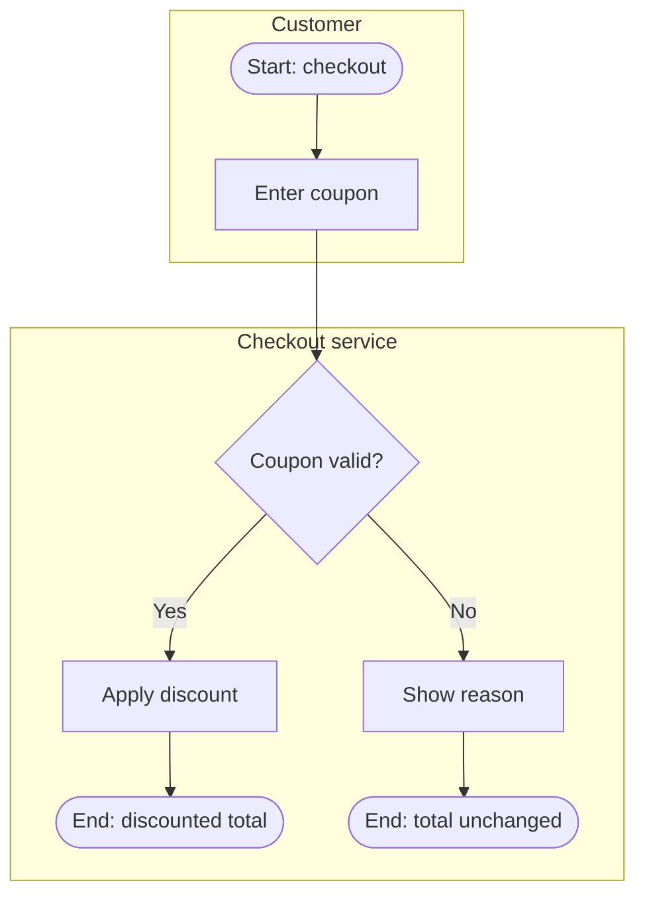

# Module 03 — Business Process Modeling

**Purpose:** understand how work happens today (AS-IS), design how it should happen (TO-BE), and
represent both clearly.

## Data needed before modeling

Trigger/start event · end states (success and failure) · actors/roles and systems · ordered activities ·
decisions and their conditions · hand-offs · exceptions and timeouts · inputs/outputs per step ·
volumes and pain points (only if given). If you lack the sequence or the actors, **ask** — do not draw a
plausible-looking process from imagination. A partial model must be labelled `Partial – based on S1`.

## Process description format

```markdown
### PRC-01 — <process name> (AS-IS | TO-BE)
**Trigger:** …   **Outcome(s):** success: … / failure: …
**Actors:** STK-001 Customer, SYS-001 Checkout service …
| Step | Actor | Activity | Input | Output | Rules | Notes / pain points | Source |
|---|---|---|---|---|---|---|---|
| 1 | Customer | Enters coupon code | Code | — | — | — | S1 |
**Decisions:** D1 — <condition> → yes: step x / no: step y
**Exceptions:** E1 — <event> → <handling> (Confirmed/Unknown)
```

## Analysis checklist (AS-IS)

- Bottlenecks: queues, approvals, single-person dependencies, batch waits.
- Redundancy: duplicate data entry, re-validation, manual copy between systems.
- Failure points: manual steps with no control, missing exception path, no ownership.
- Rework loops and their triggers.
- Integration points and data ownership.
Each observation cites the source or is labelled `Inferred`. No invented cycle times or volumes.

## TO-BE design

- Trace each change to a goal, requirement or gap (`OBJ`, `FR`, `GAP`).
- Mark each changed step: `New`, `Changed`, `Removed`, `Automated`, `Unchanged`.
- Improvement opportunities are **proposals**: `Proposed – requires validation by <owner>`.

## Mermaid conventions

Use `flowchart TD` (or `LR`) with subgraphs as lanes; keep labels short; decisions as `{…}`;
start/end as `([…])`. Mermaid is a **communication diagram, not BPMN** — never call it BPMN.



Use `sequenceDiagram` for system integrations (request/response, timeouts, retries).

## BPMN 2.0 XML

Generate BPMN XML only when: all flow nodes are known, every gateway has defined outgoing conditions,
every path reaches an end event, and the user needs an importable model. Rules:

- Root `bpmn:definitions` with `xmlns:bpmn="http://www.omg.org/spec/BPMN/20100524/MODEL"`, a
  `targetNamespace`, one `bpmn:process` (or a `bpmn:collaboration` with participants for pools).
- Unique IDs; every `sequenceFlow` has valid `sourceRef`/`targetRef`; exclusive gateway branches carry
  `conditionExpression` or a default flow.
- Diagram interchange (`bpmndi`) is optional; without it some tools auto-layout and some will not
  render. Say so.
- State explicitly: *"Not validated with a BPMN tool"* unless you actually validated it (e.g. imported
  into a modeler or ran a schema validator in this environment).

Otherwise provide a **BPMN process specification** in a table: element type (start event, user task,
service task, exclusive gateway, boundary timer event, end event), name, lane, incoming, outgoing,
condition.

## Output

AS-IS description · TO-BE description · Mermaid diagram(s) · BPMN spec or XML (when justified) ·
improvement opportunities table:

| ID | Opportunity | Addresses | Type (process/product/data/integration) | Expected benefit (qualitative) | Status |
|---|---|---|---|---|---|
