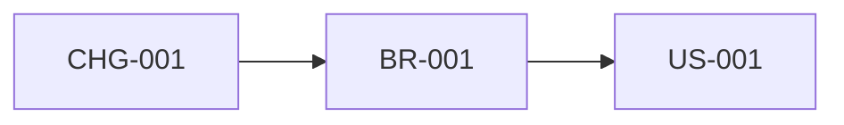

# Impact Analysis Report — <Change>

| Field | Value |
|---|---|
| Document ID | IAR-<PROJECT>-001 |
| Change ID | CHG-001 |
| Version | 0.1 |
| Status | Draft — pending review |
| Date | YYYY-MM-DD |
| Baseline analysed | <documents / versions provided> |

## 1. Change description

| Field | Value |
|---|---|
| Before | |
| After | |
| Reason | |
| Requested by (role) | |
| Source | |

## 2. Baseline and limits

<Artifacts analysed. Impacts on artifacts not provided are unknown, not absent.>

## 3. Functional impact summary

<5–10 lines.>

## 4. Change impact matrix

| IMP ID | Affected artifact | Category | Description | Severity | Confidence | Action |
|---|---|---|---|---|---|---|
| IMP-001 | | Functional / API / Data / Process / Security / Operations / Testing / Docs | | High/Medium/Low | High/Medium/Low | |

## 5. Dependencies map

## 6. Potential regression areas

| Area | Why at risk | Suggested regression focus | Linked artifacts |
|---|---|---|---|

## 7. Risk register

| RSK ID | Risk | Likelihood | Impact | Mitigation | Owner (to confirm) | Status |
|---|---|---|---|---|---|---|

## 8. Recommended actions

| # | Action | Type | Linked IMP / RSK | Status |
|---|---|---|---|---|
| 1 | | Recommendation | | Proposed |

## 9. Estimates (only if requested)

<Range, assumptions, confidence level, and "to be validated by the delivery team".>

## 10. Open questions

| ID | Priority | Question | Owner |
|---|---|---|---|

## Change log

| Version | Date | Author | Change |
|---|---|---|---|
| 0.1 | YYYY-MM-DD | | Initial draft |
